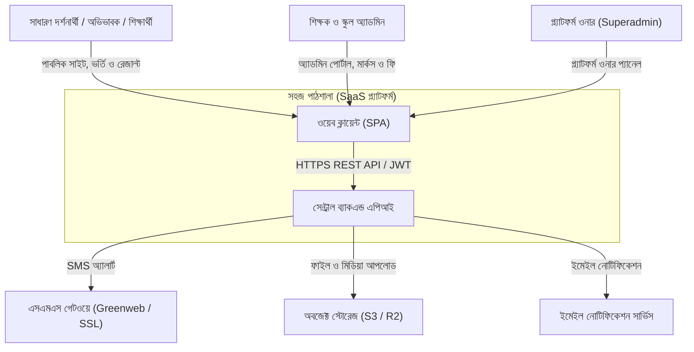
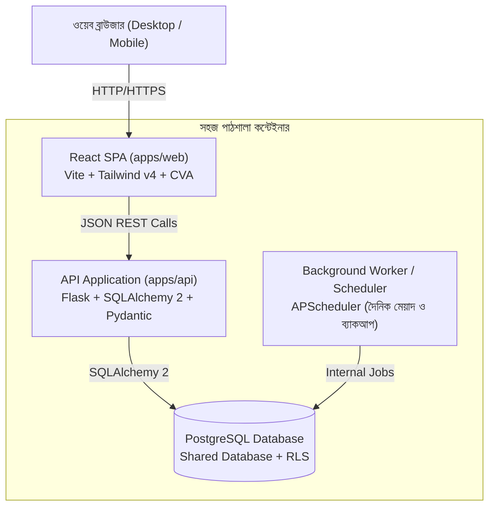
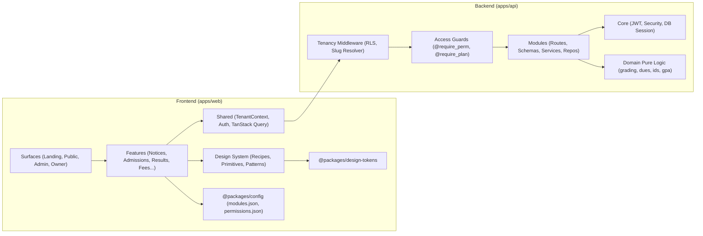

# সহজ পাঠশালা — সফটওয়্যার আর্কিটেকচার ব্লুপ্রিন্ট (System Architecture)

## ১. আর্কিটেকচারাল লক্ষ্য ও ফিলোসফি (Architecture Goals)
সহজ পাঠশালা আর্কিটেকচারের প্রধান মূলমন্ত্র হলো **"এক জিনিস, এক জায়গা" (Single Source of Truth)**।
যেকোনো রঙ, স্টাইল, লেখা, নিয়ম বা মডিউল যোগ বা পরিবর্তন করতে ঠিক একটি ফাইলে পরিবর্তন করতে হবে। পুরো সিস্টেম মডুলার, টেন্যান্ট-আইসোলেটেড, এবং স্বয়ংক্রিয়ভাবে স্কেলেবল।

---

## ২. C4 আর্কিটেকচারাল ডায়াগ্রাম (C4 Architecture Diagrams)

### ২.১ C4 Context Diagram (সিস্টেম কনটেক্সট)



---

### ২.২ C4 Container Diagram (কন্টেইনার লেভেল)



---

### ২.৩ C4 Component Diagram (কম্পোনেন্ট লেভেল)



---

## ৩. রিকোয়েস্টের জীবনচক্র ও ডেটা পথ (Request Lifecycle)

```
[Browser Request: GET /api/v1/results?class=10&roll=1]
       │
       ▼
1. CORS & Security Middleware (IP rate-limit, security headers)
       │
       ▼
2. Tenancy Middleware
   - রিকোয়েস্ট হেডার / সাবডোমেন / পাথ থেকে `school_slug` নিষ্কাশন
   - ডেটাবেসে সক্রিয় স্কুল অনুসন্ধান
   - PostgreSQL সেশনে RLS টেন্যান্ট সেট: `SET LOCAL app.current_school_id = 'sch_bdhs'`
       │
       ▼
3. Authentication & Access Guard
   - JWT টোকেন যাচাই (যদি প্রোটেক্টেড রুট হয়)
   - পারমিশন চেক: `@require_perm("results.view")`
   - প্ল্যান গেটিং চেক: `@require_plan_module("results")`
   - সাপোর্ট-মোড রাইট প্রটেকশন (যদি ওনার লগইন থাকে, মিউটেশন ব্লক)
       │
       ▼
4. Module Controller / Route Handler
   - Pydantic v2 দিয়ে ইনপুট রিকোয়েস্ট ভ্যালিডেশন
       │
       ▼
5. Business Service
   - ব্যবসায়িক কাজের সমাহার
   - `domain/grading.py` কল করে GPA ও গ্রেড পয়েন্ট বিশুদ্ধ হিসাব
       │
       ▼
6. Repository Layer
   - `TenantBaseRepository` স্বয়ংক্রিয়ভাবে `school_id == current_school_id` ফিল্টার প্রয়োগ করে
       │
       ▼
7. PostgreSQL Execution
   - Row-Level Security (RLS) পলিসি নিশ্চিত করে অন্য স্কুলের ১টি সারিও লিক হবে না
       │
       ▼
8. Pydantic Response Schema Serialization
       │
       ▼
[Response JSON: 200 OK + OpenAPI Generated Contract]
```

---

## ৪. মাল্টি-টেন্যান্ট আইসোলেশনের দুই স্তর (Two-Tier Isolation)

সহজ পাঠশালায় ডেটা সুরক্ষার জন্য **দ্বি-স্তরীয় সুরক্ষা** নিশ্চিত করা হয়েছে:

1. **অ্যাপ্লিকেশন স্তর (Software Guard):**
   - রিপোজিটরির বেস ক্লাস `TenantBaseRepository` প্রতিটি কুয়েরিতে স্বয়ংক্রিয়ভাবে `WHERE school_id = :current_school` অ্যাপেন্ড করে।
   - কোনো ডেভেলপার ভুলবশত `school_id` বাদ দিলেও অ্যাপ্লিকেশন কোড তা ব্লক করবে।

2. **ডেটাবেস স্তর (PostgreSQL Row-Level Security - RLS):**
   - প্রতিটি টেন্যান্ট-টেবিলে ডেটাবেস স্তরে RLS সক্রিয়:
     ```sql
     ALTER TABLE students ENABLE ROW LEVEL SECURITY;
     CREATE POLICY tenant_isolation_policy ON students
       FOR ALL
       TO authenticated_role
       USING (school_id = current_setting('app.current_school_id', true));
     ```
   - রিকোয়েস্ট শেষ হওয়ার সাথে সাথে কানেকশন পুলে সেশন ভ্যারিয়েবল রিসেট হয়ে যায় (`DISCARD TEMP / RESET ALL`)।

---

## ৫. থিম ও কালার ইঞ্জিন (Theme Engine)

- **ডার্ক/লাইট মোড:** CSS ভ্যারিয়েবল দ্বারা পরিচালিত। ডিফল্ট মোড ডার্ক, এক ক্লিকে লাইট।
- **Emerald ও Indigo সুইচিং:** স্কুলের ডেটাবেস রেকর্ড (`school.theme`) অথবা ওনার প্যানেলের চয়েস অনুযায়ী রুট এলিমেন্টে `data-theme="emerald"` বা `data-theme="indigo"` অ্যাট্রিবিউট বসে।
- **চারটি সমন্বয় (Four Combinations):**
  1. `dark + emerald` (ডিফল্ট বিডিএইচএস লুক)
  2. `light + emerald`
  3. `dark + indigo`
  4. `light + indigo` (ওনার প্যানেল ও কর্পোরেট লুক)
- সব কালার টোকেন একক সিএসএস ফাইল (`packages/design-tokens/src/semantic.css`) থেকে লোড হয়। কোনো ফিচারে হেক্স কোড লেখা নিষেধ।

---

## ৬. সার্ভার স্টেট ক্যাশিং ও ইনভ্যালিডেশন (TanStack Query)
- ফ্রন্টএন্ডে সমস্ত সার্ভার ডেটা `TanStack Query (React Query)` দিয়ে পরিচালিত।
- প্রতিটি কুয়েরি কীতে স্কুলের `slug` প্রিফিক্স হিসেবে বাধ্যতামূলক: `['tenant', slug, 'notices']`।
- অ্যাডমিন যখন সিএমএস বা নোটিশে সেভ বাটনে ক্লিক করে:
  ```typescript
  queryClient.invalidateQueries({ queryKey: ['tenant', slug, 'notices'] });
  queryClient.invalidateQueries({ queryKey: ['tenant', slug, 'cms'] });
  ```
- এর ফলে পাবলিক সাইট তাৎক্ষণিকভাবে রিফ্রেশ ছাড়াই লাইভ আপডেট হয়ে যায়।

---

## ৭. অডিট ও লগিং আর্কিটেকচার (Audit & Security Trail)
- আর্থিক লেনদেন (ফি আদায়, রসিদ বাতিল), ফলাফল পরিবর্তন, ইউজার পারমিশন পরিবর্তন এবং ফ্যাক্টরি রিসেট স্বয়ংক্রিয়ভাবে অডিট টেবিলে রেকর্ড হয়।
- প্রতিটি অডিট লগে সংরক্ষিত হয়: `timestamp`, `school_id`, `actor_user_id`, `actor_role`, `action_type`, `entity_id`, `old_value`, `new_value`, এবং `client_ip`।
