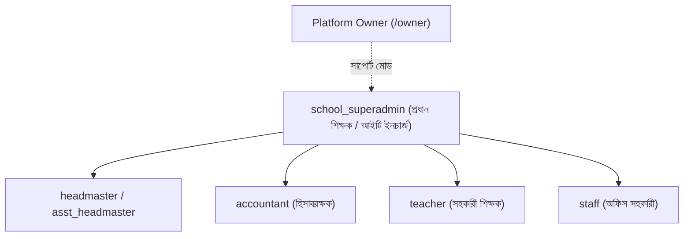

# সহজ পাঠশালা — পারসোনা ও রোল স্পেসিফিকেশন

## ১. প্ল্যাটফর্ম ওনার (Platform Owner)
- **আইডেন্টিটি:** সিস্টেম সুপার-অ্যাডমিন (`platform_owner`)
- **সারফেস:** `/owner`
- **লক্ষ্য:** পুরো প্ল্যাটফর্মের স্বাস্থ্য পর্যবেক্ষণ, নতুন স্কুলের অনবোর্ডিং অনুমোদন, বিলিং ও লাইসেন্স নিয়ন্ত্রণ।
- **প্রধান কাজ:**
  - নতুন স্কুল তৈরি, স্লাগ নির্ধারণ, EIIN ভেরিফিকেশন।
  - স্কুলের প্ল্যান নির্ধারণ (Basic, Standard, Premium) ও মেয়াদের তারিখ বৃদ্ধি।
  - স্ট্যাটাস পরিবর্তন: `active` ➔ `grace` ➔ `suspended`।
  - **সাপোর্ট মোড (Read-only Impersonation):** নির্দিষ্ট স্কুলের অ্যাডমিন পোর্টালে ঢুকে যেকোনো সমস্যা নিরীক্ষণ (কোনো ডেটা মুছে ফেলা বা তৈরি করা নিষিদ্ধ)।
  - প্ল্যাটফর্ম-ওয়াইড অডিট লগ পর্যবেক্ষণ।

---

## ২. স্কুলের অভ্যন্তরীণ রোলসমূহ (School Roles — ৬টি স্তর)

### ১. `school_superadmin` (স্কুল সুপার-অ্যাডমিন / আইটি ইনচার্জ)
- **সারফেস:** `/{slug}/admin`
- **অনুমতি:** পূর্ণ নিয়ন্ত্রণ (Full Access)।
- **দায়িত্ব:** বিদ্যালয়ের সেটিংস, ইউজার অ্যাকাউন্ট তৈরি ও পারমিশন অ্যাসাইন, সিএমএস কনফিগারেশন, ফ্যাক্টরি রিসেট (সুরক্ষিত কোড দ্বারা)।

### ২. `headmaster` ও `asst_headmaster` (প্রধান শিক্ষক ও সহকারী প্রধান শিক্ষক)
- **সারফেস:** `/{slug}/admin`
- **অনুমতি:** একাডেমিক অনুমোদন, ফলাফল প্রকাশ, ভর্তি অনুমোদন, শিক্ষক ও কর্মচারী পর্যবেক্ষণ, প্রাতিষ্ঠানিক বাণী ও নোটিশ প্রকাশ।
- **দায়িত্ব:** ফলাফল চূড়ান্ত অনুমোদন ও ডিজিটাল স্বাক্ষর সিল নিশ্চিতকরণ।

### ৩. `accountant` (হিসাবরক্ষক / ক্যাশিয়ার)
- **সারফেস:** `/{slug}/admin/fees`
- **অনুমতি:** ফি আদায়, রসিদ জেনারেশন, বকেয়া রিপোর্ট দেখা, রসিদ ক্যানসেলেশন রিকোয়েস্ট।
- **সীমাবদ্ধতা:** একাডেমিক নম্বর বা শিক্ষার্থী তথ্য পরিবর্তন করতে পারবে না।

### ৪. `teacher` (সহকারী শিক্ষক / শ্রেণি শিক্ষক)
- **সারফেস:** `/{slug}/admin/results`, `/{slug}/admin/students`
- **অনুমতি:** নিজস্ব বিষয়ের পরীক্ষার নম্বর এন্ট্রি, শ্রেণিভিত্তিক শিক্ষার্থী তালিকা দেখা, রুটিন ডাউনলোড।
- **সীমাবদ্ধতা:** ফলাফল সরাসরি পাবলিশ করতে পারে না (প্রধান শিক্ষকের অনুমোদন প্রয়োজন)।

### ৫. `staff` (অফিস সহকারী / কম্পিউটার অপারেটর)
- **সারফেস:** `/{slug}/admin/notices`, `/{slug}/admin/gallery`, `/{slug}/admin/routines`
- **অনুমতি:** নোটিশ ড্রাফট করা, ফাইল ও রুটিন আপলোড, ফটো ও ভিডিও গ্যালারি আপডেট করা।
- **সীমাবদ্ধতা:** আর্থিক লেনদেন বা ফলাফল পরিবর্তনে প্রবেশাধিকার নেই।

---

## ৩. পাবলিক পারসোনা (Public Personas)

### ১. ভর্তিচ্ছু শিক্ষার্থী ও অভিভাবক (Applicant & Guardian)
- **সারফেস:** `/{slug}#admission`
- **লক্ষ্য:** স্বচ্ছ ও সহজে ৬ষ্ঠ-৯ম শ্রেণির ভর্তি ফরম পূরণ করা।
- **প্রধান কাজ:**
  - ৩-ধাপ বিশিষ্ট ফরম পূরণ এবং পাসপোর্ট সাইজ ছবি আপলোড।
  - ইউনিক ট্র্যাকিং কোড সংগ্রহ (e.g. `BDHS-ADM-2027-1042`)।
  - ছবিসহ অফিসিয়াল ডিজিটাল প্রবেশপত্র (Admit Card) প্রিন্ট/সংরক্ষণ।
  - ট্র্যাকিং সার্চ বক্সে কোড দিয়ে আবেদনের অবস্থা (অপেক্ষমাণ/অনুমোদিত/বাতিল) দেখা।

### ২. অধ্যয়নরত শিক্ষার্থী ও অভিভাবক (Enrolled Student & Parent)
- **সারফেস:** `/{slug}#results`, `/{slug}#academics`, `/{slug}#notices`
- **লক্ষ্য:** রুটিন, পরীক্ষার নোটিশ এবং ডিজিটাল মার্কশিট সংগ্রহ।
- **প্রধান কাজ:**
  - শ্রেণি ও রোল নম্বর দিয়ে অফিশিয়াল গ্রেড ট্রান্সক্রিপ্ট ও মার্কশিট অনুসন্ধান।
  - জিপিএ, প্রাপ্ত গ্রেড এবং সাবজেক্ট নম্বর পর্যবেক্ষণ এবং প্রিন্ট/PDF ডাউনলোড।
  - ক্লাস রুটিন ও সিলেবাসের PDF ডাউনলোড।

### ৩. সাধারণ দর্শনার্থী ও প্রাক্তন শিক্ষার্থী (Visitor & Alumni)
- **সারফেস:** `/{slug}#home`, `/{slug}#about`, `/{slug}#gallery`
- **লক্ষ্য:** প্রতিষ্ঠানের ইতিহাস, বর্তমান শিক্ষকমণ্ডলীর তালিকা, ক্যাম্পাসের ছবি ও ভিডিও পরিদর্শন এবং যোগাযোগ করা।
