# সহজ পাঠশালা — পূর্ণাঙ্গ সাইটম্যাপ ও রাউটিং ট্রি

## ১. সম্পূর্ণ রাউট কাঠামো ও সারফেস ম্যাপ

```mermaid
graph TD
  Root["/ (Platform Landing)"]
  Root --> Owner["/owner (Owner Panel)"]
  Root --> Design["/design (Design System Showcase)"]
  Root --> TenantPublic["/{slug} (School Public Site)"]
  Root --> TenantLogin["/{slug}/login (School Portal Login)"]
  Root --> TenantAdmin["/{slug}/admin (School Admin Portal)"]

  %% Owner Sub-routes
  Owner --> OwnerSchools["/owner/schools (স্কুল তালিকা ও অনবোর্ডিং)"]
  Owner --> OwnerPlans["/owner/plans (প্ল্যান ও ফিচার কনফিগারেশন)"]
  Owner --> OwnerBilling["/owner/billing (সাবস্ক্রিপশন ও বিলিং হিস্ট্রি)"]
  Owner --> OwnerAudit["/owner/audit (সিস্টেম অডিট লগ)"]

  %% Tenant Public Sections (Hash Anchored)
  TenantPublic --> SecHome["#home (হিরো, পরিসংখ্যান, বাণী, একাডেমিক)"]
  TenantPublic --> SecAbout["#about (ইতিহাস, ঐতিহ্য, ভিশন, মিশন)"]
  TenantPublic --> SecCommittee["#committee (পরিচালনা পর্ষদ)"]
  TenantPublic --> SecTeachers["#teachers (শিক্ষক ও কর্মচারী পরিষদ - ১৬ সদস্য)"]
  TenantPublic --> SecAcademics["#academics (শাখা ও রুটিন ডাউনলোড)"]
  TenantPublic --> SecUniform["#uniform (পোশাক নীতিমালা ও ড্রেসকোড)"]
  TenantPublic --> SecNotices["#notices (নোটিশ বোর্ড ও জরুরি টিকার)"]
  TenantPublic --> SecAdmission["#admission (অনলাইন ভর্তি ফরম ও প্রবেশপত্র)"]
  TenantPublic --> SecResults["#results (মার্কশিট ও গ্রেড অনুসন্ধান)"]
  TenantPublic --> SecGallery["#gallery (ফটো অ্যালবাম ও ভিডিও কর্নার)"]
  TenantPublic --> SecContact["#contact (ঠিকানা, ফোন ও যোগাযোগ ফরম)"]

  %% Tenant Admin Modules (17 Modules)
  TenantAdmin --> ModDashboard["/dashboard (সারসংক্ষেপ ও মেট্রিক্স)"]
  TenantAdmin --> ModStudents["/students (শিক্ষার্থী ডিরেক্টরি)"]
  TenantAdmin --> ModAdmissions["/admissions (অনলাইন ভর্তি পর্যালোচনা)"]
  TenantAdmin --> ModResults["/results (নম্বর এন্ট্রি ও রেজাল্ট শিট)"]
  TenantAdmin --> ModFees["/fees (ফি আদায় ও ডিজিটাল রসিদ)"]
  TenantAdmin --> ModTeachers["/teachers (শিক্ষক ও স্টাফ ব্যবস্থাপনা)"]
  TenantAdmin --> ModCommittee["/committee (ম্যানেজিং কমিটি)"]
  TenantAdmin --> ModRoutines["/routines (রুটিন ও সিলেবাস আপলোড)"]
  TenantAdmin --> ModGallery["/gallery (ফটো ও ভিডিও গ্যালারি)"]
  TenantAdmin --> ModNotices["/notices (নোটিশ বোর্ড ও জরুরি টিকার)"]
  TenantAdmin --> ModCms["/cms (ওয়েবসাইট সিএমএস কনফিগারেশন)"]
  TenantAdmin --> ModSettings["/settings (প্রাতিষ্ঠানিক সেটিংস)"]
  TenantAdmin --> ModAcademicSetup["/academic-setup (ক্লাস, সেকশন ও গ্রেড স্কেল)"]
  TenantAdmin --> ModMessages["/messages (এসএমএস নোটিফিকেশন ও লগ)"]
  TenantAdmin --> ModReports["/reports (ট্যাবুলেশন ও পরিসংখ্যান রিপোর্ট)"]
  TenantAdmin --> ModUsers["/users (ব্যবহারকারী ও রোল ম্যানেজমেন্ট)"]
  TenantAdmin --> ModAudit["/audit (অ্যাক্টিভিটি ও অডিট লগ)"]
```

---

## ২. সারফেসভিত্তিক রাউট তালিকা

### সারফেস ১: প্ল্যাটফর্ম ও মার্কেটিং
| রাউট | পেজ শিরোনাম | দৃশ্যমানতা | উদ্দেশ্য |
|---|---|---|---|
| `/` | সহজ পাঠশালা — মাল্টি-স্কুল SaaS প্ল্যাটফর্ম | পাবলিক | প্রোডাক্ট ল্যান্ডিং পেজ, ফিচারস, প্রাইসিং ও স্কুল অনবোর্ডিং রিকোয়েস্ট |
| `/design` | Sohoj Pathshala Design System Showcase | ইন্টারনাল / ডেভেলপার | ৪টি থিম কম্বিনেশন (Dark/Light × Emerald/Indigo) ও সব UI উপাদানের টেস্ট বেড |
| `*` | 404 — পৃষ্ঠাটি পাওয়া যায়নি | যেকোনো ভুল ইউআরএল | স্ট্যান্ডার্ড ফলব্যাক এরর পেজ |

---

### সারফেস ২: প্ল্যাটফর্ম ওনার (`/owner`)
| রাউট | মডিউল নাম | অ্যাক্সেস গার্ড | কাজ |
|---|---|---|---|
| `/owner` | ড্যাশবোর্ড ওভারভিউ | `platform_owner` | মোট স্কুল, সক্রিয় সাবস্ক্রিপশন, মাসিক রাজস্ব ও সার্ভার স্বাস্থ্য |
| `/owner/schools` | স্কুল ব্যবস্থাপনা | `platform_owner` | নতুন স্কুল তৈরি, স্ট্যাটাস সুইচ (Active/Grace/Suspended), মেয়াদ বৃদ্ধি |
| `/owner/plans` | প্ল্যান কনফিগারেশন | `platform_owner` | বেসিক, স্ট্যান্ডার্ড, প্রিমিয়ামের মূল্য ও কোটা নির্ধারণ |
| `/owner/billing` | সাবস্ক্রিপশন ও লেজার | `platform_owner` | স্কুলের পেমেন্ট ইতিহাস ও রিনিউয়াল রেকর্ড |
| `/owner/audit` | কেন্দ্রীয় অডিট লগ | `platform_owner` | প্ল্যাটফর্মের সকল ক্রিটিক্যাল অ্যাকশন ট্র্যাকিং |

---

### সারফেস ৩: স্কুলের পাবলিক ওয়েবসাইট (`/{slug}`)
| হ্যাশ ভিউ | সেকশনের নাম | প্রধান উপাদান |
|---|---|---|
| `#{slug}#home` | প্রাতিষ্ঠানিক হোমপেজ | হিরো ব্যানার স্লাইডার, জরুরি টিকার, ৪টি স্ট্যাটাস মেট্রিক, প্রধান শিক্ষকের বাণী, একাডেমিক শাখা, সুবিধাসমূহ, সর্বশেষ নোটিশ |
| `#{slug}#about` | পরিচিতি ও ঐতিহ্য | ইতিহাস, ভিশন, মিশন, অফিসিয়াল তথ্যাবলী (EIIN, MPO, কোড) |
| `#{slug}#committee` | গভর্নিং বডি | সভাপতি ও সদস্যবৃন্দের তালিকা, ছবি, মেয়াদ ও পদবী |
| `#{slug}#teachers` | শিক্ষক ও কর্মচারী | ১৬ সদস্যের পূর্ণাঙ্গ প্যানেল (ক্যানোনিকাল সিকোয়েন্স), সেগমেন্টেড ফিল্টার ও রিয়েলটাইম সার্চ |
| `#{slug}#academics` | শাখা ও রুটিন | ক্লাস রুটিন, পরীক্ষার সময়সূচি ও সিলেবাস ডাউনলোড |
| `#{slug}#uniform` | পোশাক নীতিমালা | ছাত্রদের ও ছাত্রীদের ড্রেসকোড গাইডলাইন ও ব্যাজ নির্দেশিকা |
| `#{slug}#notices` | নোটিশ বোর্ড | বিভাগভিত্তিক নোটিশ তালিকা, ফুল মডাল রিডার ও সংযুক্তি ডাউনলোড |
| `#{slug}#admission` | অনলাইন ভর্তি | ৩-ধাপের ফরম, পাসপোর্ট ছবি আপলোড, ট্র্যাকিং লুকআপ ও অ্যাডমিট স্লিপ প্রিন্ট |
| `#{slug}#results` | ফলাফল অনুসন্ধান | শ্রেণি ও রোল সার্চ, গ্রেড ট্রান্সক্রিপ্ট ও মার্কশিট প্রিন্ট |
| `#{slug}#gallery` | মিডিয়া গ্যালারি | ফটো অ্যালবাম ফিল্টার ও ভিডিও প্লেয়ার লাইটবক্স মডাল |
| `#{slug}#contact` | যোগাযোগ | গুগল ম্যাপ এমবেড, ঠিকানা, ফোন ও ইনকোয়ারি ফরম |

---

### সারফেস ৪: স্কুলের অ্যাডমিন পোর্টাল (`/{slug}/admin`)
| পাথ | মডিউল | প্রয়োজনীয় রোল | প্ল্যান টাইপ |
|---|---|---|---|
| `/{slug}/login` | পোর্টাল লগইন | পাবলিক (লগইন করা ছাড়া) | সকল প্ল্যান |
| `/{slug}/admin` | ওভারভিউ ড্যাশবোর্ড | সকল অনুমোদিত ইউজার | সকল প্ল্যান |
| `/{slug}/admin/students` | শিক্ষার্থী ডিরেক্টরি | superadmin, teacher | সকল প্ল্যান |
| `/{slug}/admin/admissions` | ভর্তি আবেদন রিভিউ | superadmin, headmaster | সকল প্ল্যান |
| `/{slug}/admin/results` | রেজাল্ট ও মার্কস | superadmin, teacher | Basic (সাধারণ), Standard/Premium (ট্যাবুলেশন) |
| `/{slug}/admin/fees` | ফি ও রসিদ ব্যবস্থাপনা | superadmin, accountant | Standard, Premium |
| `/{slug}/admin/teachers` | শিক্ষক পরিষদ ম্যানেজমেন্ট | superadmin | সকল প্ল্যান |
| `/{slug}/admin/committee` | পরিচালনা পর্ষদ | superadmin | সকল প্ল্যান |
| `/{slug}/admin/routines` | রুটিন ও সিলেবাস | superadmin, staff | সকল প্ল্যান |
| `/{slug}/admin/gallery` | ফটো ও ভিডিও কর্নার | superadmin, staff | Standard, Premium |
| `/{slug}/admin/notices` | নোটিশ প্রকাশনা | superadmin, staff | সকল প্ল্যান |
| `/{slug}/admin/cms` | সিএমএস কনফিগারেশন | superadmin | সকল প্ল্যান |
| `/{slug}/admin/settings` | স্কুল সেটিংস | superadmin | সকল প্ল্যান |
| `/{slug}/admin/users` | ইউজার ও পারমিশন | superadmin | Standard (৮ জন), Premium (১৫ জন) |
