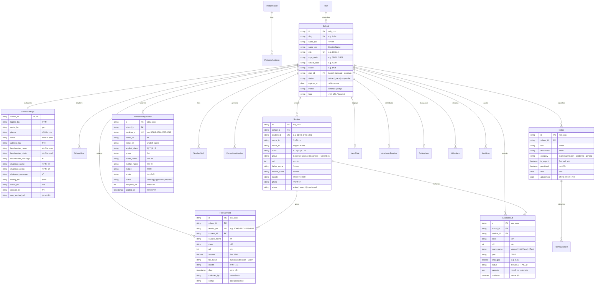

# সহজ পাঠশালা — ডেটা ও ডোমেন মডেল স্পেসিফিকেশন (Domain Model)

## ১. প্ল্যাটফর্ম ও টেন্যান্ট সম্পর্ক (Entity-Relationship Diagram)

---

## ২. আইসোলেশন ও কনস্ট্রেইন্ট নীতি (Isolation & Integrity Rules)

1. **টেন্যান্ট আইসোলেশন বাউন্ডারি:**
   - ডেটাবেসের প্রতিটি টেন্যান্ট-টেবিলে প্রথম কলাম বাধ্যতামূলকভাবে `school_id`।
   - ইউনিক কনস্ট্রেইন্ট কখনই গ্লোবাল হবে না; এটি কম্পোজিট হবে:
     - `UNIQUE(school_id, student_id)`
     - `UNIQUE(school_id, class, roll)` — একই স্কুলে একই ক্লাসে দুইজনের একই রোল হতে পারবে না।
     - `UNIQUE(school_id, receipt_no)`
2. **আইডি ফরম্যাটিং (Deterministic Identifiers):**
   - স্কুল স্লাগ প্রিফিক্স ভিত্তিক অটো-ফরম্যাট:
     - শিক্ষার্থী: `{SLUG_UPPER}-STD-{YEAR}-{SERIAL4}` (e.g. `BDHS-STD-2026-0001`)
     - ভর্তি ট্র্যাকিং: `{SLUG_UPPER}-ADM-{YEAR}-{SERIAL4}` (e.g. `BDHS-ADM-2027-0104`)
     - রসিদ নম্বর: `{SLUG_UPPER}-REC-{YEAR}-{SERIAL5}` (e.g. `BDHS-REC-2026-00042`)
3. **Aggregate Roots:**
   - `School` হলো রুট টেন্যান্ট অ্যাগ্রিগেট।
   - `Student` হলো একাডেমিক ও আর্থিক ট্রানজেকশনের অ্যাগ্রিগেট।
   - কোনো চাইল্ড রেকর্ড (রসিদ, রেজাল্ট, হাজিরা) সরাসরি প্যারেন্ট ছাড়া তৈরি বা ডিলিট হতে পারবে না।

