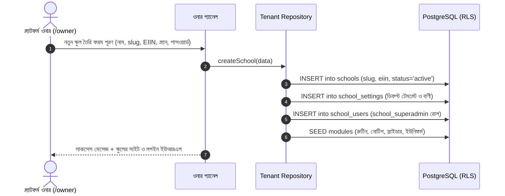
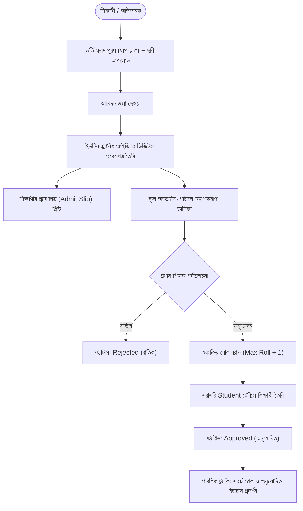
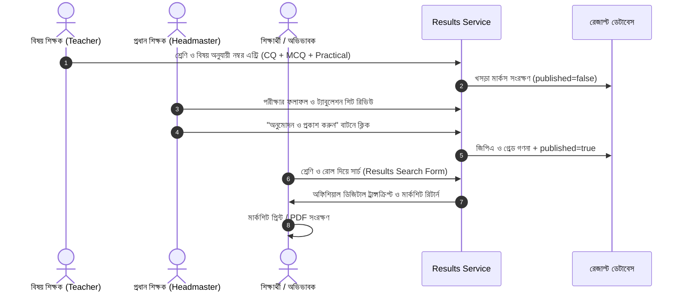
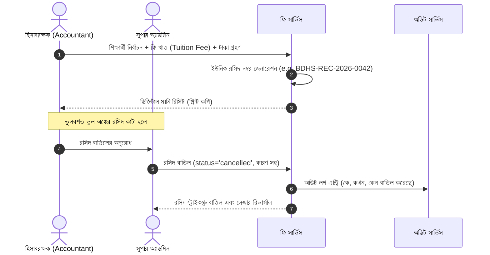
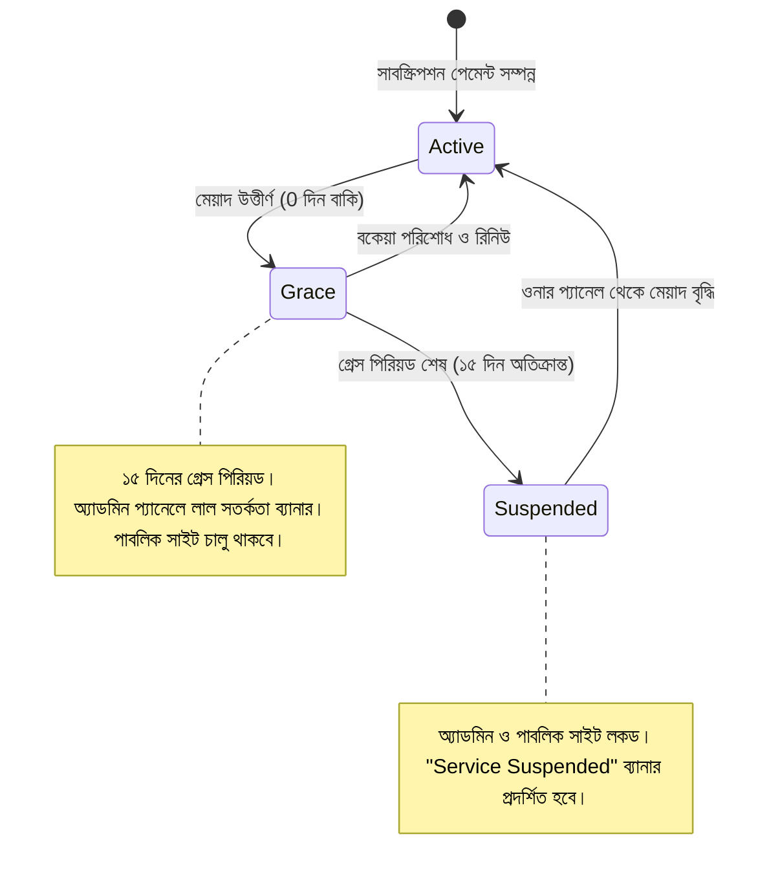
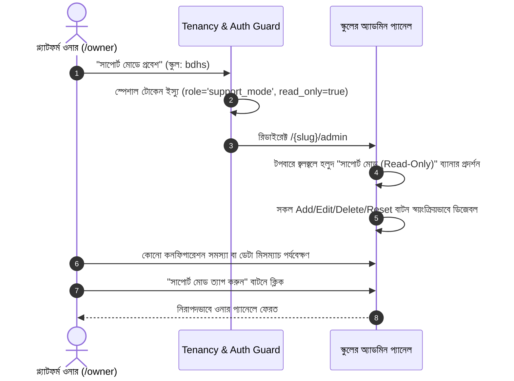

# সহজ পাঠশালা — ব্যবহারকারী ফ্লো স্পেসিফিকেশন (User Flows)

## ১. স্কুল অনবোর্ডিং ও রেজিস্ট্রেশন ফ্লো

---

## ২. অনলাইন ভর্তি আবেদন ➔ রোল বরাদ্দ ➔ শিক্ষার্থী অনুমোদন

---

## ৩. পরীক্ষার ফলাফল এন্ট্রি ➔ প্রধান শিক্ষকের অনুমোদন ➔ পাবলিক মার্কশিট অনুসন্ধান

---

## ৪. ফি আদায় ➔ ডিজিটাল রসিদ ➔ বাতিলকরণ (Audit Invalidation)

---

## ৫. সাবস্ক্রিপশন লাইফসাইকেল (Active ➔ Grace ➔ Suspended ➔ Renewal)

---

## ৬. সাপোর্ট মোড ফ্লো (Impersonation by Platform Owner)

