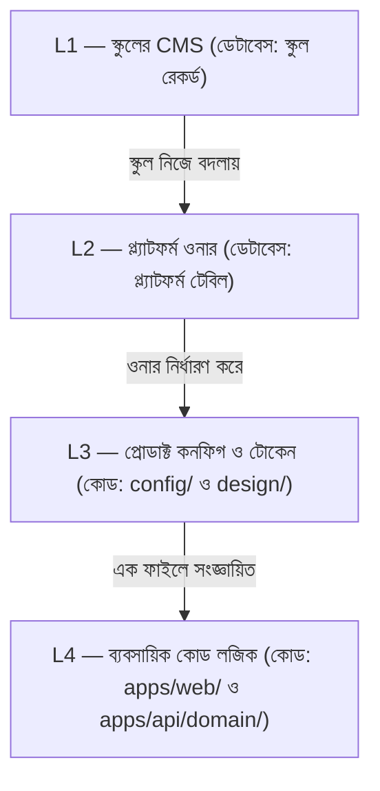

# সহজ পাঠশালা — কনফিগারেবিলিটি ম্যাট্রিক্স (Configurability Matrix)

## ১. চার স্তরের কনফিগারেশন নীতি (Four-Tier Architecture)

কোনো সেটিংস বা নিয়মের উৎস যেন একাধিক না হয়, সেজন্য সহজ পাঠশালায় প্রতিটি কনফিগারেবল উপাদানকে নিচের ৪টি সুনির্দিষ্ট স্তরের ঠিক একটিতে ম্যাপিং করা হয়েছে:

---

## ২. কনফিগারেশন ম্যাট্রিক্স তালিকা

| আইটেম / ফিচার | স্তর | কে বদলায় | সংরক্ষণের স্থান / ফাইল | উদাহরণ ও নিয়ম |
|---|:---:|---|---|---|
| **স্কুলের নাম, EIIN, বোর্ড** | **L1** | স্কুলের অ্যাডমিন / ওনার | DB (`schools` টেবিল) | "বন্দুয়া দৌলতপুর উচ্চ বিদ্যালয়", ১০৬৬৪৪ |
| **স্কুলের লোগো ও মনোগ্রাম** | **L1** | স্কুলের অ্যাডমিন | DB (`schools.logo`, `school_settings.logo`) | হেডার ও সার্টিফিকেটে প্রদর্শিত ছবি |
| **স্কুলের কালার থিম নির্বাচন** | **L1** | স্কুলের অ্যাডমিন | DB (`schools.theme`) | Emerald (সবুজ) অথবা Indigo (নীল) |
| **ডিফল্ট মোড (ডার্ক/লাইট)** | **L1** | স্কুলের অ্যাডমিন | DB (`school_settings.default_mode`) | ভিজিটর প্রথম ঢুকলে ডার্ক নাকি লাইট দেখবে |
| **হিরো স্লাইডারের ছবি ও লেখা** | **L1** | স্কুলের অ্যাডমিন | DB (`hero_slides` টেবিল) | শিরোনাম, সাবটাইটেল, ট্যাগ ও ব্যানার ছবি |
| **হোমপেজের সেকশনের ক্রম ও অন/অফ** | **L1** | স্কুলের অ্যাডমিন | DB (`school_settings.sections_config`) | নোটিশ উপরে নাকি শিক্ষক তালিকা উপরে |
| **প্রধান শিক্ষক ও সভাপতির বাণী** | **L1** | স্কুলের অ্যাডমিন | DB (`school_settings` টেবিল) | ছবি, নাম, পদবী ও সম্পূর্ণ প্রাতিষ্ঠানিক বক্তব্য |
| **পোশাক নীতিমালা (Uniform)** | **L1** | স্কুলের অ্যাডমিন | DB (`uniform_policies` টেবিল) | শার্ট, প্যান্ট, ফ্রক, স্কার্ফ ও জুতার নির্দেশিকা |
| **স্কুলের নিজস্ব গ্রেড স্কেল** | **L1** | স্কুলের অ্যাডমিন | DB (`grade_scales` টেবিল) | ৮০-১০০: A+ (৫.০০), ৭০-৭৯: A (৪.০০) |
| **ফি-এর খাত ও টাকার হার** | **L1** | স্কুলের অ্যাডমিন | DB (`fee_heads` টেবিল) | মাসিক বেতন: ৫০০ ৳, ভর্তি ফি: ১২০০ ৳ |
| **প্ল্যানের সীমা ও মডিউল কোটা** | **L2** | প্ল্যাটফর্ম ওনার | DB (`plans` টেবিল) | Basic: ৩০০ শিক্ষার্থী, Standard: ৮০০ শিক্ষার্থী |
| **সাবস্ক্রিপশন প্ল্যানের মূল্য** | **L2** | প্ল্যাটফর্ম ওনার | DB (`plans.price_monthly`) | ১৫০০ ৳, ২৫০০ ৳, ৪০০০ ৳ |
| **স্কুলভিত্তিক স্পেশাল ওভাররাইড** | **L2** | প্ল্যাটফর্ম ওনার | DB (`schools.feature_overrides`) | কোনো স্কুলের জন্য নির্দিষ্ট মডিউল বিশেষ ছাড় দেওয়া |
| **ফুটারের প্ল্যাটফর্ম ক্রেডিট** | **L2** | প্ল্যাটফর্ম ওনার | DB (`platform_settings.footer_credit`) | "সহজ পাঠশালা দ্বারা পরিচালিত" |
| **ডিফল্ট অনবোর্ডিং টেমপ্লেট** | **L2** | প্ল্যাটফর্ম ওনার | DB (`platform_templates` টেবিল) | নতুন স্কুলের প্রাথমিক ডামি কনটেন্ট |
| **ডিজাইন টোকেন (রং, শেড)** | **L3** | ডেভেলপার | `packages/design-tokens/src/{primitives,semantic}.css` | `--c-primary`, `--c-surface`, `--c-bg` |
| **ফন্ট ও টাইপোগ্রাফি স্কেল** | **L3** | ডেভেলপার | `packages/design-tokens/src/typography.css` | Hind Siliguri, ফন্ট সাইজ ও line-height |
| **বর্ডার রেডিয়াস, শ্যাডো, স্পেসিং** | **L3** | ডেভেলপার | `packages/design-tokens/src/shape.css` | `--radius-btn`, `--radius-card`, shadow-xs |
| **কম্পোনেন্ট রেসিপি (CVA)** | **L3** | ডেভেলপার | `apps/web/src/design/recipes/*.ts` | বাটন প্যাডিং, কার্ড বর্ডার, ব্যাজ ভ্যারিয়েন্ট |
| **আইকন ম্যাপিং** | **L3** | ডেভেলপার | `apps/web/src/design/icons.ts` | notice ➔ Bell, fee ➔ CreditCard |
| **UI টেক্সট ও অনুবাদ (i18n)** | **L3** | ডেভেলপার | `packages/i18n/{bn,en}/*.json` | বাটন টেক্সট, লেবেল, সাধারণ ত্রুটি বার্তা |
| **অ্যাডমিন মডিউল রেজিস্ট্রি** | **L3** | ডেভেলপার | `packages/config/modules.json` | রাউট, আইকন, পারমিশন ও সাইডবার ক্রম |
| **পাবলিক সেকশন রেজিস্ট্রি** | **L3** | ডেভেলপার | `packages/config/public-sections.json` | হ্যাশ, নাম, ডিফল্ট ক্রম ও কম্পোনেন্ট ম্যাপ |
| **পারমিশন ও রোলের ডিফল্ট ম্যাট্রিক্স**| **L3** | ডেভেলপার | `packages/config/permissions.json` | কোন রোলের কোন পারমিশন ডিফল্ট পাবে |
| **আইডি ও রসিদের নম্বর ফরম্যাট** | **L3** | ডেভেলপার | `packages/config/formats.json` | `BDHS-REC-{YEAR}-{SERIAL5}` |
| **ফাইল সাইজ ও সিকিউরিটি লিমিট** | **L3** | ডেভেলপার | `packages/config/limits.json` | ইমেজ: ২ মেগাবাইট, ভিডিও: ১০ মেগাবাইট |
| **জিপিএ ও গ্রেড পয়েন্ট গণনার লজিক**| **L4** | ডেভেলপার | `apps/api/app/domain/grading.py` | স্কেল অনুযায়ী বিষয়ভিত্তিক GPA ও গড় পয়েন্ট |
| **স্বয়ংক্রিয় রোল বরাদ্দের অ্যালগরিদম**| **L4** | ডেভেলপার | `apps/api/app/domain/roll_allocation.py`| শ্রেণিতে শেষ রোল + ১ বরাদ্দ ও জ্যাম নিরসন |
| **টাকা কথায় রূপান্তর (বাংলা/ইংরেজি)**| **L4** | ডেভেলপার | `apps/api/app/domain/amount_in_words.py`| রসিদে "পাঁচশত টাকা মাত্র" মুদ্রণ লজিক |
| **সাবস্ক্রিপশন স্ট্যাটাস চেক** | **L4** | ডেভেলপার | `apps/api/app/domain/subscription_status.py`| মেয়াদ শেষ ➔ ১৫ দিনের গ্রেস ➔ সাসপেন্ড |

---

## ৩. পরম কঠোর নিয়ম (Strict Architectural Invariant)
1. যা **L1** বা **L2** (স্কুল বা ওনারের তথ্য), তা কখনো **L3** বা **L4**-এ কোডের ভেতরে হার্ডকোড থাকবে না।
2. যা **L3** (টোকেন, রেজিস্ট্রি, কনফিগ), তা কখনো কোনো ফিচারের ভেতরের ফাইলে ছড়িয়ে থাকবে না; ঠিক একটি কেন্দ্রীয় ফাইলে থাকবে।
3. ফিচার ফোল্ডারের কোড শুধুমাত্র **L3**-এর টোকেন ও কম্পোনেন্ট ব্যবহার করবে এবং **L4**-এর বিশুদ্ধ ফাংশন কল করবে।

